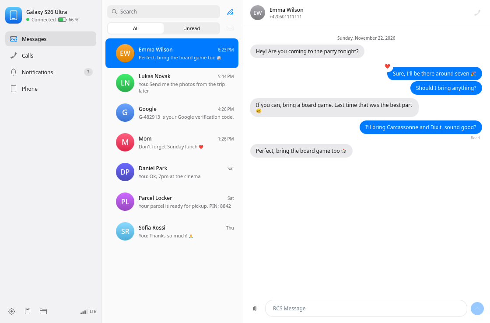

<p align="center"></p>

<h1 align="center">Continuity</h1>

<p align="center">
  <b>Your Android phone on the Linux desktop.</b><br>
  Texts, calls, notifications and more in one polished window, in the spirit of macOS Continuity.
</p>

<p align="center">
  
  
  
  
  
</p>

<p align="center">
  <picture>
    <source media="(prefers-color-scheme: dark)" srcset="docs/screenshots/messages-dark.png">
    
  </picture>
</p>

Linux can already do a lot with an Android phone. KDE Connect syncs texts and notifications,
PipeWire can act as a Bluetooth car kit, and Google Messages speaks RCS. **Continuity** puts all
of that behind one clean, macOS-style interface. You can answer a call from the corner of your
screen, reply to a text without leaving your game, and paste a login code straight from an SMS.

## ✨ Features

| | |
|---|---|
| 💬 **Messages** | **SMS and RCS** (chats with iPhones included) via Google Messages: full history, replies and new conversations, photos and files, reactions, *Sent / Delivered / Read*, green SMS vs blue RCS bubbles, an unread filter and local *mark as unread*. Falls back to SMS/MMS over KDE Connect when Google Messages isn't paired. |
| 🔔 **Message banners** | New messages slide in at the top-right corner, even when the window is hidden. **Reply inline** without opening the app, or click to jump to the conversation. |
| 🔑 **Security codes** | One-time codes ("G-482913 is your verification code") are detected automatically and shown big with a **Copy Code** button. Amounts, dates and phone numbers are ignored. |
| 📞 **Calls** | A floating call window above everything, fullscreen apps included: caller name or number, **Answer / Decline**, then a live timer, **mute microphone**, **mute sound** and **hang up**. Call audio runs through your computer's mic and speakers or headset. Dial pad and contacts are built in. |
| 🎵 **Now Playing** | See and control what's playing on the phone: artwork, seek bar, play/pause, next/previous, and switching between player apps. |
| 📋 **Clipboard** | Text you copy on the computer appears on the phone. You can also send the clipboard on demand. |
| 📱 **Phone** | Battery and signal, *Find My Phone*, send files by drag and drop (like AirDrop), browse phone storage, sync contacts. |
| 🔔 **Notifications** | Everything that shows up on the phone, with quick replies, *dismiss on the phone* and *Clear All*. |
| 🧩 **Desktop** | Unread badge on the dock or taskbar icon, tray icon, runs in the background, starts at login, follows **light and dark mode** live. English and Czech UI. |

Both floating windows (calls and message banners) can be dragged anywhere and remember where you
left them.

<p align="center">
  <picture>
    <source media="(prefers-color-scheme: dark)" srcset="docs/screenshots/banners-dark.png">
    
  </picture>
</p>

<p align="center">
  <picture>
    <source media="(prefers-color-scheme: dark)" srcset="docs/screenshots/phone-dark.png">
    
  </picture>
</p>

## 🛠 How it works

Continuity is a front end over three well-established pieces. It doesn't run a server or
a cloud service of its own.

```
 ┌─────────────┐   Wi-Fi · KDE Connect     ┌─────────────┐  D-Bus  ┌──────────────┐
 │             │ ────────────────────────▶ │ kdeconnectd │ ──────▶ │              │
 │   Android   │   Bluetooth HFP           ┌─────────────┐  D-Bus  │  Continuity  │
 │    phone    │ ────────────────────────▶ │  PipeWire   │ ──────▶ │   (Qt/QML)   │
 │             │   Google Messages (web)   ┌─────────────┐  stdio  │              │
 │             │ ◀───────────────────────▶ │ libgm helper│ ──────▶ │              │
 └─────────────┘                           └─────────────┘         └──────────────┘
```

- **[KDE Connect](https://kdeconnect.kde.org/)** (Wi-Fi) handles messages, contacts,
  notifications, battery, files, clipboard and media control. Continuity talks to the
  running `kdeconnectd` over D-Bus.
- **Bluetooth Hands-Free (HFP) via PipeWire.** The computer acts like a car kit for the phone.
  PipeWire ≥ 1.2 exposes calls on D-Bus (`org.pipewire.Telephony`). Continuity answers,
  declines and dials through it and routes call audio with `pw-loopback`.
- **Google Messages for Web** (SMS + RCS) runs through a small Go helper built on
  [libgm](https://github.com/mautrix/gmessages) from mautrix-gmessages (`helper/gmessages`).
  You pair it once with your Google account and confirm a matching emoji on the phone.

Floating windows use **wlr-layer-shell** (LayerShellQt) on Wayland, so they stay above other
windows without stealing focus. Other sessions get an always-on-top window instead.

## 📦 Requirements

- Linux with a session D-Bus (developed and tested on **KDE Plasma 6, Wayland**)
- Python ≥ 3.11, **PySide6** ≥ 6.6, PyGObject, Kirigami, LayerShellQt
- **KDE Connect** on the computer and the **KDE Connect** app on the phone
  ([Play Store](https://play.google.com/store/apps/details?id=org.kde.kdeconnect_tp) /
  [F-Droid](https://f-droid.org/packages/org.kde.kdeconnect_tp/))
- *For calls:* a Bluetooth adapter, **PipeWire ≥ 1.2** with WirePlumber (`pw-loopback`, `pactl`)
- *For RCS:* Go ≥ 1.22 to build the helper, plus a Chromium-based browser for the one-time sign-in

On Arch Linux and derivatives:

```bash
sudo pacman -S pyside6 python-gobject kirigami layer-shell-qt kdeconnect pipewire-pulse qt6-tools go
```

## 🚀 Install

```bash
git clone https://github.com/d56Wr/continuity.git
cd continuity
./scripts/install-dev.sh
```

The script builds the translations and the Google Messages helper. It also installs a
`continuity` launcher into `~/.local/bin` and adds a menu entry. No root is needed, and the
app runs straight from the cloned folder, so a `git pull` updates it.

Start it from the app menu or with `continuity`. Turn on *Start at login* on the **Phone** page
to keep it running in the tray.

## 📲 Phone setup

1. **KDE Connect.** Install the app, join the same network and pair it with the computer.
   Grant SMS, phone, contacts and notification access, and enable the **Contacts
   synchronizer** plugin so messages show names.
2. **Calls.** Pair the phone with the computer over **Bluetooth** and allow **Calls** for it.
   Leave *Media audio* off unless you want the phone's music on the computer.
3. **RCS (optional).** On the **Phone** page click *Sign in with Google*, sign in, then tap the
   matching emoji in Google Messages on the phone. Google Messages has to be the phone's
   default SMS app.

## ⌨️ Command line

```text
continuity               open the window (or bring the running one to the front)
continuity --background  start hidden in the tray
continuity --answer      answer the ringing call
continuity --hangup      decline or hang up
continuity --toggle-call answer if ringing, otherwise hang up
```

The call commands are handy as global shortcuts or on a Stream Deck key.

## ⚙️ Configuration

Settings live in `~/.config/continuity/settings.json`. Most of them are on the **Phone** page.
Call audio uses the default speaker and microphone. To route it elsewhere, for example into
a mixer channel, set `callSpeaker` / `callMicrophone` to a PipeWire node name.

## 🔒 Privacy

Everything stays on your machine. Messages and contacts travel between the phone and the
computer over KDE Connect's encrypted local connection. The only outside connection is the
Google Messages helper, which uses the same protocol as
[messages.google.com](https://messages.google.com/web). Its session is stored in
`~/.local/share/continuity/gmessages` with owner-only permissions.

## 🌍 Translations

Strings live in `po/*.ts` (Qt Linguist). To add a language, add its code to
`scripts/update-translations.sh`, run it, translate the new `.ts` file in Qt Linguist and run
`scripts/build-translations.sh`. Pull requests are welcome.

## ⚠️ Limitations

- Calls need Bluetooth HFP. KDE Connect alone can only show and silence them.
- Android doesn't let apps read the clipboard in the background. To send the phone's clipboard
  to the computer, use *Send clipboard* in the KDE Connect notification or quick-settings tile.
- RCS relies on an **unofficial** client of Google's web protocol, and Google may change it at
  any time.
- *Mark as unread* is local to Continuity. The Google Messages protocol has no such action.
- Call history and voicemail aren't available.

## 🙏 Credits

Built on [KDE Connect](https://invent.kde.org/network/kdeconnect-kde),
[PipeWire](https://pipewire.org/), [mautrix-gmessages / libgm](https://github.com/mautrix/gmessages),
[Qt / PySide6](https://www.qt.io/qt-for-python), [Kirigami](https://develop.kde.org/frameworks/kirigami/)
and [LayerShellQt](https://invent.kde.org/plasma/layer-shell-qt).

## 📄 License

**GPL-3.0-or-later.** The Google Messages helper in `helper/gmessages` is **AGPL-3.0-or-later**
because libgm is.

Continuity is an independent project and is not affiliated with Apple, Google or KDE.
"macOS" and "Continuity" are used only to describe the idea.
