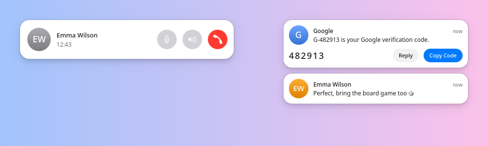
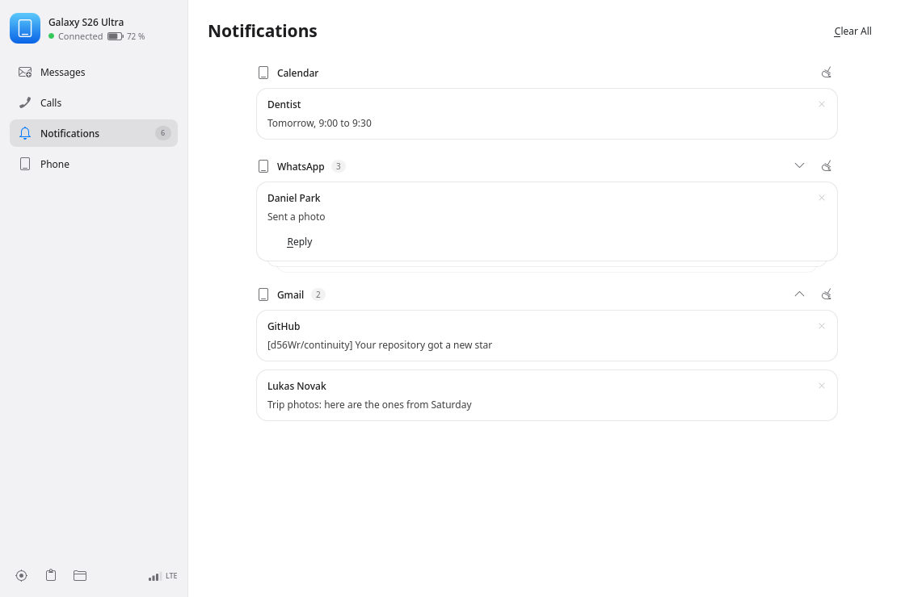
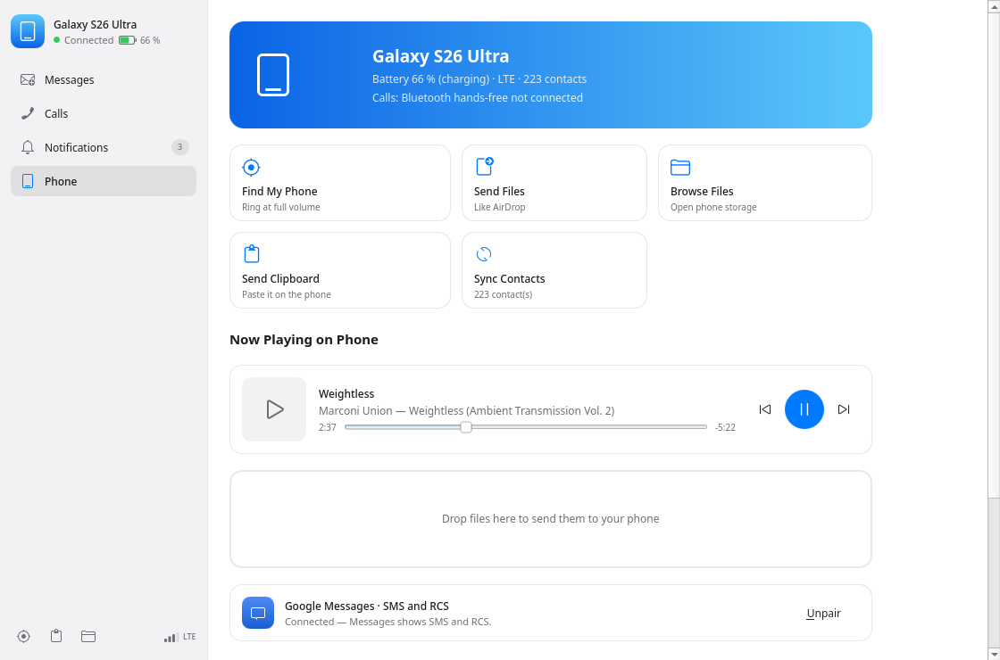

<p align="center"></p>

<h1 align="center">Continuity</h1>

<p align="center">
  <b>Your Android phone on the Linux desktop.</b><br>
  Texts, calls and notifications in one polished app, in the spirit of macOS Continuity.
</p>

<p align="center">
  
  
  
  
</p>

<p align="center">
  <a href="#-install">Install</a> ·
  <a href="#-features">Features</a> ·
  <a href="#-phone-setup">Phone setup</a> ·
  <a href="#-more">More</a>
</p>

<p align="center">
  <picture>
    <source media="(prefers-color-scheme: dark)" srcset="docs/screenshots/messages-dark.png">
    
  </picture>
</p>

## ✨ Features

- 💬 **Messages.** SMS and RCS through Google Messages, chats with iPhones included. Full
  history, photos, reactions and read receipts.
- 🔔 **Banners.** Texts and app notifications slide in at the corner of the screen. Reply right
  there.
- 🔑 **Security codes.** Login codes from texts get a **Copy Code** button.
- 📞 **Calls.** Answer, decline and talk through the computer, with a floating call window.
- 🗂 **Notifications.** Everything from the phone, grouped by app like on the phone.
- 🎵 **Now Playing.** Control the music playing on the phone.
- 📋 **Clipboard and files.** Copy here, paste on the phone. Drag files over like AirDrop.
- 🌗 **At home on the desktop.** Light and dark mode, an unread badge on the dock, a tray icon
  and starting at login.

<table>
  <tr>
    <td width="50%">
      <picture>
        <source media="(prefers-color-scheme: dark)" srcset="docs/screenshots/banners-dark.png">
        
      </picture>
      <p align="center"><sub>Call window and banners, drag them anywhere</sub></p>
    </td>
    <td width="50%">
      <picture>
        <source media="(prefers-color-scheme: dark)" srcset="docs/screenshots/notifications-dark.png">
        
      </picture>
      <p align="center"><sub>Notifications grouped by app</sub></p>
    </td>
  </tr>
  <tr>
    <td colspan="2">
      <picture>
        <source media="(prefers-color-scheme: dark)" srcset="docs/screenshots/phone-dark.png">
        
      </picture>
      <p align="center"><sub>Phone status, Now Playing and quick actions</sub></p>
    </td>
  </tr>
</table>

## 📦 Install

**Arch Linux, CachyOS, EndeavourOS, Manjaro** — build and install it as a regular package:

```bash
git clone https://github.com/d56Wr/continuity.git
cd continuity/packaging/arch
makepkg -si
```

**Any other distribution** — the install script checks what's missing, offers to install it
(Arch and Fedora) and sets Continuity up for your user, without root:

```bash
git clone https://github.com/d56Wr/continuity.git
cd continuity
./install.sh
```

Then open **Continuity** from the app menu. To update, run `git pull` and install again.
To remove it, run `./install.sh --uninstall` (or `sudo pacman -R continuity-git`).

## 📲 Phone setup

1. **KDE Connect.** Install [KDE Connect](https://play.google.com/store/apps/details?id=org.kde.kdeconnect_tp)
   on the phone and pair it with the computer. Allow SMS, phone, contacts and notifications.
2. **Calls.** Pair the phone with the computer over **Bluetooth**. Continuity reconnects it by
   itself whenever the phone is nearby.
3. **RCS (optional).** On the **Phone** page click *Sign in with Google* and confirm the emoji in
   Google Messages on the phone.

## 📖 More

<details>
<summary><b>How it works</b></summary>

Continuity is a front end over three well-established pieces. It has no server or cloud
service of its own.

```
 ┌─────────────┐   Wi-Fi · KDE Connect     ┌─────────────┐  D-Bus  ┌──────────────┐
 │             │ ────────────────────────▶ │ kdeconnectd │ ──────▶ │              │
 │   Android   │   Bluetooth HFP           ┌─────────────┐  D-Bus  │  Continuity  │
 │    phone    │ ────────────────────────▶ │  PipeWire   │ ──────▶ │   (Qt/QML)   │
 │             │   Google Messages (web)   ┌─────────────┐  stdio  │              │
 │             │ ◀───────────────────────▶ │ libgm helper│ ──────▶ │              │
 └─────────────┘                           └─────────────┘         └──────────────┘
```

- **[KDE Connect](https://kdeconnect.kde.org/)** (Wi-Fi) brings texts, contacts, notifications,
  battery, files, clipboard and media control.
- **Bluetooth Hands-Free via PipeWire** makes the computer a car kit for the phone. PipeWire ≥ 1.2
  exposes calls on D-Bus (`org.pipewire.Telephony`).
- **Google Messages for Web** (SMS + RCS) runs through a small Go helper built on
  [libgm](https://github.com/mautrix/gmessages) (`helper/gmessages`).

The floating windows use **wlr-layer-shell** on Wayland, so they stay on top without stealing
focus. While Continuity shows the phone's notifications, KDE Connect's own popups are turned
off so nothing shows up twice.
</details>

<details>
<summary><b>Requirements</b></summary>

- KDE Plasma 6 on Wayland (other desktops work, with fewer niceties)
- Python ≥ 3.11, PySide6 ≥ 6.6, PyGObject, Kirigami, LayerShellQt
- KDE Connect on the computer and on the phone
- *Calls:* a Bluetooth adapter and PipeWire ≥ 1.2
- *RCS:* Go ≥ 1.22 to build the helper

`install.sh` checks all of these for you.
</details>

<details>
<summary><b>Command line and shortcuts</b></summary>

```text
continuity               open the window (or bring the running one to the front)
continuity --background  start hidden in the tray
continuity --answer      answer the ringing call
continuity --hangup      decline or hang up
continuity --toggle-call answer if ringing, otherwise hang up
```

The call commands work well as global shortcuts or on a Stream Deck key.
</details>

<details>
<summary><b>Settings</b></summary>

Most settings are on the **Phone** page: sounds, banners, clipboard sharing, Bluetooth
reconnect, language and starting at login. Click *Test Notification* there and drag the banner
to where banners should appear.

Everything is stored in `~/.config/continuity/settings.json`. Call audio uses the default
speaker and microphone. To route it elsewhere, set `callSpeaker` / `callMicrophone` to a
PipeWire node name.
</details>

<details>
<summary><b>Privacy</b></summary>

Everything stays on your machine. The phone and the computer talk over KDE Connect's encrypted
local connection and Bluetooth. The only outside connection is the Google Messages helper,
which uses the same protocol as [messages.google.com](https://messages.google.com/web). Its
session is stored in `~/.local/share/continuity/gmessages`, readable only by you.
</details>

<details>
<summary><b>Limitations</b></summary>

- Calls need Bluetooth. Over Wi-Fi alone, KDE Connect can only announce them.
- Android doesn't let apps read the clipboard in the background. To send the phone's clipboard,
  use *Send clipboard* in the KDE Connect notification on the phone.
- RCS uses an **unofficial** client of Google's web protocol, which Google may change.
- *Mark as unread* stays local. Google Messages has no such action.
- No call history or voicemail yet.
</details>

<details>
<summary><b>Translations</b></summary>

The app is in English and Czech. Strings live in `po/*.ts` (Qt Linguist). To add a language,
add its code to `scripts/update-translations.sh`, run it, translate the new file in Qt Linguist
and send a pull request.
</details>

## 🙏 Credits and license

Built on [KDE Connect](https://invent.kde.org/network/kdeconnect-kde),
[PipeWire](https://pipewire.org/), [mautrix-gmessages / libgm](https://github.com/mautrix/gmessages),
[Qt / PySide6](https://www.qt.io/qt-for-python), [Kirigami](https://develop.kde.org/frameworks/kirigami/)
and [LayerShellQt](https://invent.kde.org/plasma/layer-shell-qt).

**GPL-3.0-or-later.** The Google Messages helper in `helper/gmessages` is **AGPL-3.0-or-later**
because libgm is. Continuity is an independent project, not affiliated with Apple, Google or KDE.
